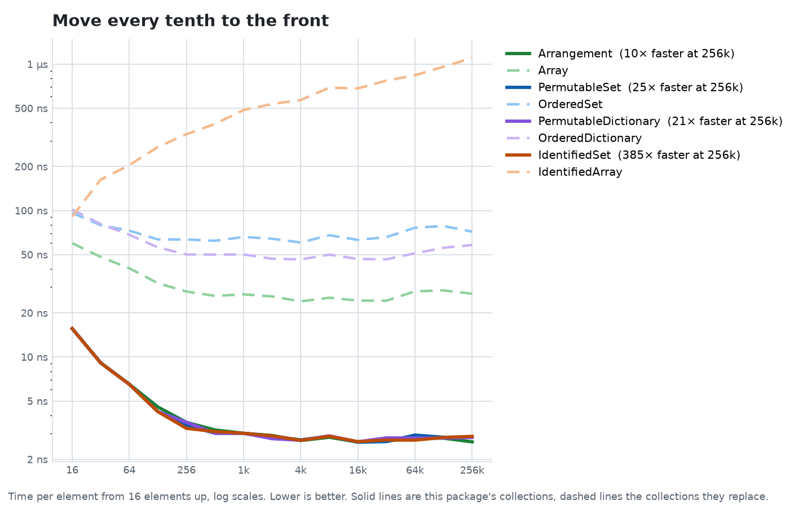
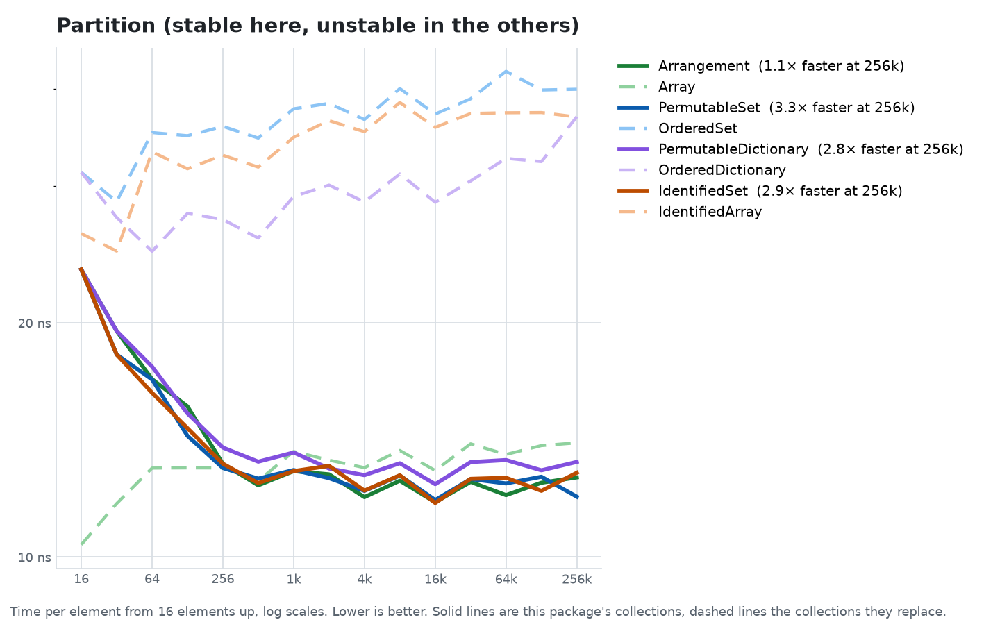

# Benchmark results

These charts and tables compare the package's collections with the ones people most often reach for:

- **`Arrangement`** against `Array`, both holding a typical app model: a UUID id, an `Int` sort key and 64 bytes of other fields (`Record`).
- **`PermutableSet`** against [swift-collections](https://github.com/apple/swift-collections)' `OrderedSet`, both holding `Record`.
- **`PermutableDictionary`** against swift-collections' `OrderedDictionary`, both mapping `Int` keys to `Record` values.
- **`IdentifiedSet`** against [Point-Free's](https://github.com/pointfreeco/swift-identified-collections) `IdentifiedArray`, both holding `Record`.

Every figure is **time per element**: the fastest of three runs of the whole operation, divided by the number of elements. Lower is better.

Measured on 2026-11-08 on a GitHub `macos-latest` runner (Apple silicon), release build, with [swift-collections-benchmark](https://github.com/apple/swift-collections-benchmark). Absolute numbers will differ on your machine. The ratios are what to read.

## Summary

- **Reordering is where the design pays off.** Every reorder moves 4-byte offsets instead of 96-byte records and leaves the hash index alone. At 16k elements, reversing runs 17× faster than `Array` and 64–71× faster than `OrderedSet`, `OrderedDictionary` and `IdentifiedArray`. Rotating runs 3.5× faster than `Array` and 72–422× faster than the rest. Sorting runs 1.7–2× faster than `Array` and `OrderedSet`, and 10–11× faster than `IdentifiedArray` and `OrderedDictionary`.
- **Discarding the result skips the permutation.** When a call ignores the `Permutation` it could return, the collection rewrites its offsets directly. Moving one element is 13× faster than `Array` and `OrderedSet` and 900× faster than `IdentifiedArray`. Moving every tenth element to the front, as a multi-row drag in SwiftUI does, is 9–24× faster than rebuilding and 259× faster than `IdentifiedArray`.
- **Partitioning is faster and stable.** `stablePartition(by:)` keeps both groups in their original order and still runs 2.3–3.1× faster than the unstable `partition(by:)` of `OrderedSet`, `OrderedDictionary` and `IdentifiedArray`, and 1.1× faster than `Array`'s.
- **Removing one element at a time scales.** At 16k elements, removing by value, key or id is 51–110× faster than the competitors. At 256k, the competitors didn't finish inside the benchmark's time limit.
- **Building, lookups and inserts are mostly faster.** Building, appending, set operations and lookups in sets run 1.2–3.5× faster at 16k. Dictionary lookup reads through one more table than `OrderedDictionary` and is 1.4–2.3× slower, and `contains(id:)` evens out with `IdentifiedArray` at 256k.
- **Iteration is the one steady cost for sets.** Each read goes through the offset table, so a `for` loop over a set is about 1.4–1.5× slower than `OrderedSet` and `IdentifiedArray`. Dictionary iteration is 1.4× faster than `OrderedDictionary`.

## Charts

Each chart shows one operation with every collection that supports it. Each pair has its own color: the package's collection is the darker solid line and the collection it replaces is the lighter dashed line. The legend gives the speedup at the largest size both finished. Lines start at 16 elements, below which a call's fixed cost swamps the time per element.


### Reordering






### Building, lookup and removal


### Set operations


## Tables

The note after each operation compares the two at the largest size both finished. The partition rows compare this package's stable partition with the other collections' unstable `partition(by:)`. In the removal rows, "1%" means 1% of the elements are removed one at a time in random order. Each removal in `OrderedSet` and `IdentifiedArray` shifts every later element. In `PermutableSet` and `IdentifiedSet`, the last stored element fills the hole and only a 4-byte offset shifts.

### Arrangement vs Array

| Operation | Type | 16 | 1,024 | 16,384 | 262,144 |
| --- | --- | ---: | ---: | ---: | ---: |
| sort(by:) (1.4× faster) | Arrangement | 39 ns | 64 ns | 103 ns | 157 ns |
| | Array | 52 ns | 139 ns | 173 ns | 213 ns |
| shuffle() (3.5× faster) | Arrangement | 50 ns | 54 ns | 51 ns | 53 ns |
| | Array | 57 ns | 70 ns | 68 ns | 183 ns |
| reverse() (16.9× faster) | Arrangement | 5.19 ns | 0.61 ns | 0.43 ns | 0.46 ns |
| | Array | 7.81 ns | 7.36 ns | 7.49 ns | 7.77 ns |
| rotate by a third (6.6× faster) | Arrangement | 5.19 ns | 0.65 ns | 0.43 ns | 0.44 ns |
| | Array | 10 ns | 1.79 ns | 1.51 ns | 2.91 ns |
| move first to last (16.2× faster) | Arrangement | 5.19 ns | 0.24 ns | 0.13 ns | 0.17 ns |
| | Array | 5.19 ns | 1.59 ns | 1.70 ns | 2.69 ns |
| move every tenth to the front (10.3× faster) | Arrangement | 16 ns | 3.01 ns | 2.62 ns | 2.63 ns |
| | Array | 60 ns | 27 ns | 24 ns | 27 ns |
| partition by odd rank (1.1× faster) | Arrangement | 23 ns | 13 ns | 12 ns | 13 ns |
| | Array | 10 ns | 14 ns | 13 ns | 14 ns |

### PermutableSet vs swift-collections OrderedSet

| Operation | Type | 16 | 1,024 | 16,384 | 262,144 |
| --- | --- | ---: | ---: | ---: | ---: |
| init from array (1.3× faster) | PermutableSet | 111 ns | 38 ns | 37 ns | 67 ns |
| | OrderedSet | 50 ns | 52 ns | 48 ns | 86 ns |
| append one at a time (1.2× faster) | PermutableSet | 161 ns | 144 ns | 139 ns | 213 ns |
| | OrderedSet | 148 ns | 177 ns | 170 ns | 264 ns |
| successful contains (1.6× faster) | PermutableSet | 29 ns | 45 ns | 45 ns | 127 ns |
| | OrderedSet | 68 ns | 68 ns | 69 ns | 200 ns |
| iteration (1.5× slower) | PermutableSet | 16 ns | 13 ns | 12 ns | 13 ns |
| | OrderedSet | 10 ns | 9.03 ns | 8.52 ns | 9.09 ns |
| remove 1% one at a time (110.1× faster) | PermutableSet | 13 ns | 3.83 ns | 21 ns | 360 ns |
| | OrderedSet | 26 ns | 111 ns | 2.3 µs | – |
| sort (1.6× faster) | PermutableSet | 42 ns | 64 ns | 104 ns | 169 ns |
| | OrderedSet | 91 ns | 176 ns | 212 ns | 276 ns |
| shuffle (3.5× faster) | PermutableSet | 49 ns | 54 ns | 51 ns | 56 ns |
| | OrderedSet | 104 ns | 112 ns | 111 ns | 196 ns |
| reverse (64.6× faster) | PermutableSet | 5.19 ns | 0.53 ns | 0.44 ns | 0.47 ns |
| | OrderedSet | 18 ns | 23 ns | 28 ns | 30 ns |
| rotate by a third (114.0× faster) | PermutableSet | 5.19 ns | 0.57 ns | 0.43 ns | 0.45 ns |
| | OrderedSet | 50 ns | 42 ns | 43 ns | 52 ns |
| move first to last (21.4× faster) | PermutableSet | 5.19 ns | 0.20 ns | 0.13 ns | 0.15 ns |
| | OrderedSet | 16 ns | 2.16 ns | 1.71 ns | 3.13 ns |
| move every tenth to the front (25.3× faster) | PermutableSet | 16 ns | 3.01 ns | 2.62 ns | 2.84 ns |
| | OrderedSet | 96 ns | 66 ns | 63 ns | 72 ns |
| partition by odd rank (3.3× faster) | PermutableSet | 23 ns | 13 ns | 12 ns | 12 ns |
| | OrderedSet | 31 ns | 38 ns | 37 ns | 40 ns |
| union half-overlapping (1.2× faster) | PermutableSet | 122 ns | 98 ns | 96 ns | 171 ns |
| | OrderedSet | 96 ns | 100 ns | 100 ns | 200 ns |
| intersection half-overlapping (1.6× faster) | PermutableSet | 47 ns | 63 ns | 62 ns | 92 ns |
| | OrderedSet | 81 ns | 99 ns | 104 ns | 147 ns |
| subtracting half-overlapping (1.7× faster) | PermutableSet | 47 ns | 61 ns | 62 ns | 85 ns |
| | OrderedSet | 83 ns | 98 ns | 104 ns | 145 ns |

### IdentifiedSet vs Point-Free IdentifiedArray

| Operation | Type | 16 | 1,024 | 16,384 | 262,144 |
| --- | --- | ---: | ---: | ---: | ---: |
| init from array (3.5× faster) | IdentifiedSet | 77 ns | 34 ns | 35 ns | 43 ns |
| | IdentifiedArray | 184 ns | 140 ns | 132 ns | 150 ns |
| append one at a time (2.2× faster) | IdentifiedSet | 128 ns | 132 ns | 130 ns | 156 ns |
| | IdentifiedArray | 263 ns | 321 ns | 307 ns | 347 ns |
| successful contains(id:) (about even) | IdentifiedSet | 29 ns | 38 ns | 39 ns | 105 ns |
| | IdentifiedArray | 70 ns | 58 ns | 60 ns | 96 ns |
| subscript(id:) read (1.3× faster) | IdentifiedSet | 47 ns | 54 ns | 54 ns | 151 ns |
| | IdentifiedArray | 78 ns | 82 ns | 81 ns | 195 ns |
| iteration (1.4× slower) | IdentifiedSet | 16 ns | 13 ns | 12 ns | 12 ns |
| | IdentifiedArray | 10 ns | 9.07 ns | 8.43 ns | 8.91 ns |
| remove(id:) 1% (91.5× faster) | IdentifiedSet | 13 ns | 3.54 ns | 21 ns | 340 ns |
| | IdentifiedArray | 16 ns | 94 ns | 1.9 µs | – |
| removeAll(where:) half (2.7× faster) | IdentifiedSet | 18 ns | 29 ns | 28 ns | 31 ns |
| | IdentifiedArray | 42 ns | 79 ns | 76 ns | 83 ns |
| reverse() (71.2× faster) | IdentifiedSet | 5.19 ns | 0.53 ns | 0.44 ns | 0.45 ns |
| | IdentifiedArray | 23 ns | 27 ns | 31 ns | 32 ns |
| shuffle() (3.8× faster) | IdentifiedSet | 52 ns | 54 ns | 50 ns | 53 ns |
| | IdentifiedArray | 109 ns | 121 ns | 116 ns | 199 ns |
| sort(by:) (8.2× faster) | IdentifiedSet | 44 ns | 65 ns | 104 ns | 157 ns |
| | IdentifiedArray | 471 ns | 916 ns | 1.1 µs | 1.3 µs |
| rotate by a third (421.4× faster) | IdentifiedSet | 5.19 ns | 0.61 ns | 0.43 ns | 0.44 ns |
| | IdentifiedArray | 162 ns | 195 ns | 183 ns | 186 ns |
| move first to last (741.2× faster) | IdentifiedSet | 5.19 ns | 0.24 ns | 0.13 ns | 0.17 ns |
| | IdentifiedArray | 120 ns | 128 ns | 119 ns | 123 ns |
| move every tenth to the front (384.7× faster) | IdentifiedSet | 16 ns | 3.01 ns | 2.64 ns | 2.87 ns |
| | IdentifiedArray | 91 ns | 485 ns | 684 ns | 1.1 µs |
| partition by odd rank (2.9× faster) | IdentifiedSet | 23 ns | 13 ns | 12 ns | 13 ns |
| | IdentifiedArray | 26 ns | 35 ns | 36 ns | 37 ns |

### PermutableDictionary vs swift-collections OrderedDictionary

| Operation | Type | 16 | 1,024 | 16,384 | 262,144 |
| --- | --- | ---: | ---: | ---: | ---: |
| init from keys and values (1.7× faster) | PermutableDictionary | 7.81 ns | 12 ns | 15 ns | 16 ns |
| | OrderedDictionary | 16 ns | 20 ns | 24 ns | 27 ns |
| subscript insert one at a time (1.2× faster) | PermutableDictionary | 117 ns | 125 ns | 120 ns | 126 ns |
| | OrderedDictionary | 125 ns | 151 ns | 144 ns | 154 ns |
| subscript lookup (2.3× slower) | PermutableDictionary | 29 ns | 36 ns | 39 ns | 123 ns |
| | OrderedDictionary | 16 ns | 22 ns | 27 ns | 52 ns |
| iteration (1.4× faster) | PermutableDictionary | 21 ns | 16 ns | 15 ns | 15 ns |
| | OrderedDictionary | 23 ns | 22 ns | 21 ns | 21 ns |
| removeValue(forKey:) 1% (51.3× faster) | PermutableDictionary | 16 ns | 4.56 ns | 22 ns | 321 ns |
| | OrderedDictionary | 18 ns | 55 ns | 1.1 µs | – |
| sort by key (10.3× faster) | PermutableDictionary | 31 ns | 56 ns | 79 ns | 108 ns |
| | OrderedDictionary | 352 ns | 800 ns | 885 ns | 1.1 µs |
| shuffle (2.5× faster) | PermutableDictionary | 49 ns | 56 ns | 51 ns | 60 ns |
| | OrderedDictionary | 86 ns | 98 ns | 93 ns | 150 ns |
| reverse (77.8× faster) | PermutableDictionary | 5.19 ns | 0.53 ns | 0.44 ns | 0.47 ns |
| | OrderedDictionary | 26 ns | 31 ns | 30 ns | 36 ns |
| rotate by a third (82.6× faster) | PermutableDictionary | 5.19 ns | 0.53 ns | 0.43 ns | 0.46 ns |
| | OrderedDictionary | 44 ns | 32 ns | 31 ns | 38 ns |
| move first to last (45.4× faster) | PermutableDictionary | 5.25 ns | 0.16 ns | 0.13 ns | 0.15 ns |
| | OrderedDictionary | 18 ns | 4.56 ns | 3.39 ns | 6.86 ns |
| move every tenth to the front (20.6× faster) | PermutableDictionary | 16 ns | 3.01 ns | 2.63 ns | 2.82 ns |
| | OrderedDictionary | 102 ns | 50 ns | 47 ns | 58 ns |
| partition by odd rank (2.8× faster) | PermutableDictionary | 23 ns | 14 ns | 12 ns | 13 ns |
| | OrderedDictionary | 31 ns | 29 ns | 29 ns | 37 ns |
| sort by value (5.6× faster) | PermutableDictionary | 60 ns | 92 ns | 133 ns | 202 ns |
| | OrderedDictionary | 365 ns | 774 ns | 897 ns | 1.1 µs |
| shuffle values among keys (2.8× faster) | PermutableDictionary | 68 ns | 59 ns | 56 ns | 70 ns |
| | OrderedDictionary | 63 ns | 73 ns | 70 ns | 194 ns |

### Median times for one reorder

These medians come from an earlier run, before reorders that discard their result skipped building the permutation, so they understate the single move in particular. Measured with `swift run -c release PermutationComparisons`, which reports the median of 201 runs of the whole operation at 16,384 elements rather than time per element. `Arrangement` and `IdentifiedSet` hold `Record` values, `PermutableSet` holds `Int` values, and each pair receives the same random generator for shuffles. Every competitor uses its own API where it has one. `Array` and `OrderedSet` have no rotate, so they rebuild from two slices, and `OrderedSet` moves an element by removing and appending it. `IdentifiedArray` moves and rotates through `move(fromOffsets:toOffset:)`.

| Reorder | Arrangement | Array | PermutableSet | OrderedSet | IdentifiedSet | IdentifiedArray |
| --- | ---: | ---: | ---: | ---: | ---: | ---: |
| Sort | 2.2 ms | 3.4 ms (1.6×) | 1.1 ms | 1.3 ms (1.1×) | 2.2 ms | 20.0 ms (9.2×) |
| Shuffle | 126 µs | 290 µs (2.3×) | 126 µs | 492 µs (3.9×) | 141 µs | 1.5 ms (11×) |
| Reverse | 62 µs | 173 µs (2.8×) | 41 µs | 399 µs (9.8×) | 44 µs | 645 µs (15×) |
| Move first to last | 16 µs | 32 µs (2.0×) | 17 µs | 7 µs (0.4×) | 17 µs | 3.2 ms (187×) |
| Rotate by a third | 27 µs | 35 µs (1.3×) | 38 µs | 430 µs (11×) | 42 µs | 4.6 ms (110×) |

Each ratio is the competitor's time divided by the permutable collection's time, so a ratio above 1 means the permutable collection is faster.

The same run also times one result of the cycle arithmetic directly. Applying a shuffle 1,000 times to an `Array` of 16,384 records takes 444 ms. Raising the shuffle to the 1,000th power with `raised(to:)` and applying it once to an `Arrangement` takes 163 µs, about 2,700× faster, because the power splits each cycle in one pass whatever the exponent.

## Reproducing

Start the **Benchmarks** workflow from the Actions tab. It uploads `results.json`, the charts and the tables as an artifact. Or run locally:

```sh
cd Benchmarks
swift run -c release PermutationBenchmarks run results.json --cycles 3 --max-size 256k
python3 Scripts/charts.py results.json Charts
python3 Scripts/tables.py results.json
```

`Scripts/charts.py` needs matplotlib (`pip install matplotlib`). The median comparison above comes from `swift run -c release PermutationComparisons`.
