# Benchmark results

These charts and tables compare the package's collections with the ones people most often reach for:

- **`Arrangement`** against `Array`, both holding a typical app model: a UUID id, an `Int` sort key and 64 bytes of other fields (`Record`).
- **`PermutableSet`** against [swift-collections](https://github.com/apple/swift-collections)' `OrderedSet`, both holding `Int`.
- **`PermutableDictionary`** against swift-collections' `OrderedDictionary`, both mapping `Int` to `Int`.
- **`IdentifiedSet`** against [Point-Free's](https://github.com/pointfreeco/swift-identified-collections) `IdentifiedArray`, both holding `Record`.

Every figure is **time per element**: the fastest of three runs of the whole operation, divided by the number of elements. Lower is better.

Measured on 2026-11-08 on a GitHub `macos-latest` runner (Apple silicon), release build, with [swift-collections-benchmark](https://github.com/apple/swift-collections-benchmark). Absolute numbers will differ on your machine. The ratios are what to read.

## Summary

- **Reordering is where the design pays off.** At 16k elements, reversing runs 4.3× faster than `Array`, 9.5× faster than `OrderedSet` and 15× faster than `IdentifiedArray`. Rotating runs 17× faster than `OrderedSet` and `OrderedDictionary` and 141× faster than `IdentifiedArray`, because only 4-byte offsets move and the hash index is never touched.
- **Removing one element at a time scales.** At 16k elements, removing by value, key or id is 55–94× faster than the competitors. At 256k, the competitors didn't finish inside the benchmark's time limit.
- **Lookups and inserts are mostly faster.** These run 1.3–3.7× faster across sizes. The exception is `contains(id:)` at 256k, which is 1.2× slower than `IdentifiedArray`.
- **Moving one element is the close call.** `Arrangement` moves 2.2× faster than `Array` and `IdentifiedSet` 148× faster than `IdentifiedArray`, but `OrderedSet` and `OrderedDictionary` win, because removing and appending one `Int` is a single memmove while the package also builds the `Permutation` that `move(from:to:)` returns.
- **Iteration is the one steady cost.** Each read goes through the order array, so a `for` loop over `Int`s is 5× slower than `OrderedSet` (0.5 ns against 0.1 ns per element), 6× slower than `OrderedDictionary`, and 1.4× slower than `IdentifiedArray` over `Record`s. Converting to an `Array` or calling `withContiguousStorageIfAvailable` reads storage directly while the collection is still in storage order.

## Charts

Each chart shows one operation with every collection that supports it. Each pair has its own color: the package's collection is the darker solid line and the collection it replaces is the lighter dashed line. The legend gives the speedup at the largest size both finished. Lines start at 16 elements, below which a call's fixed cost swamps the time per element.

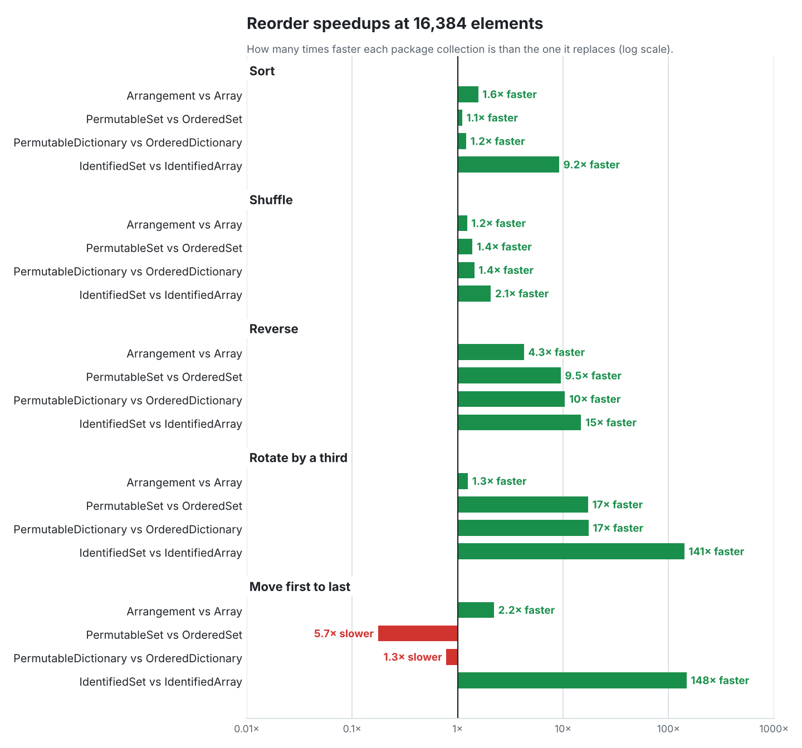

### Reordering

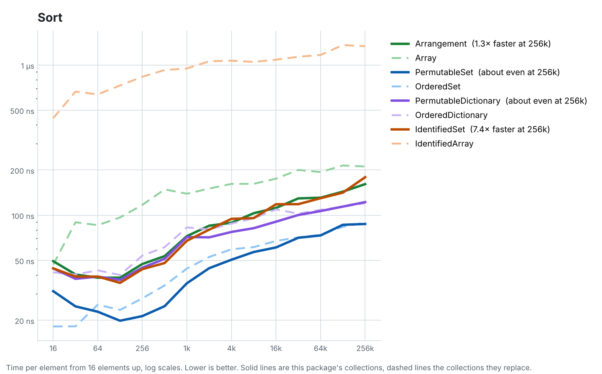

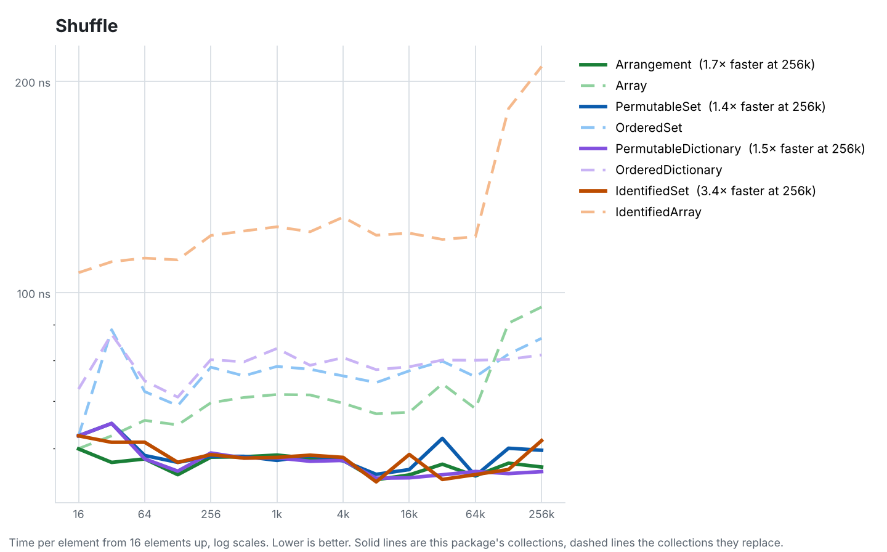

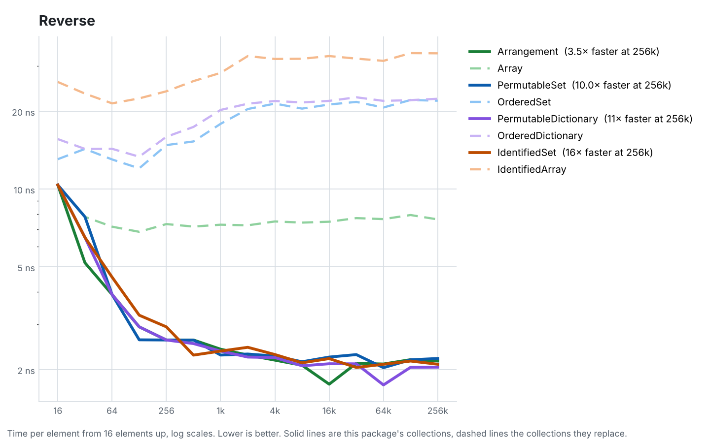

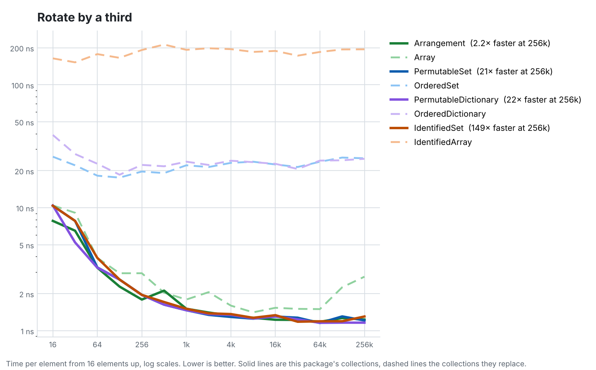

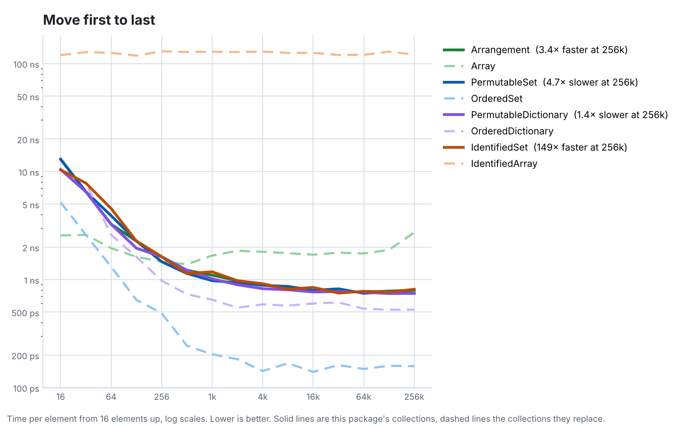

### Building, lookup and removal

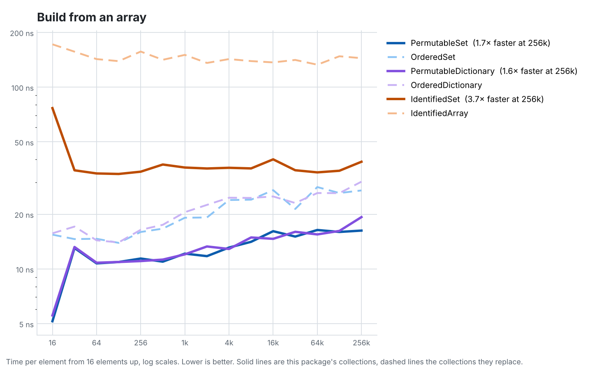

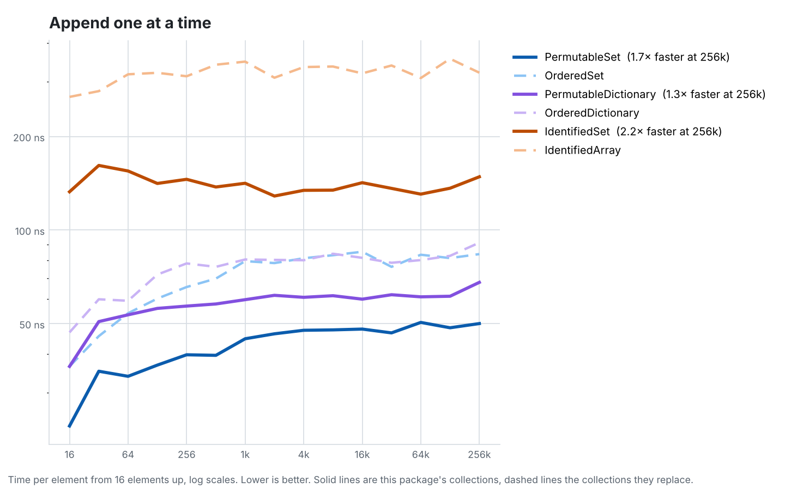

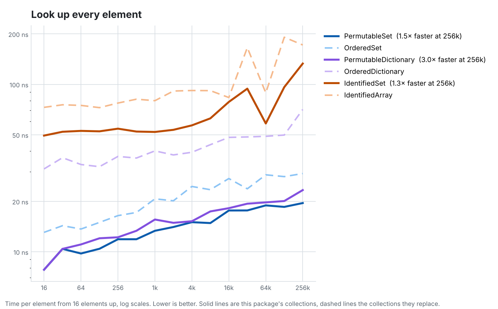

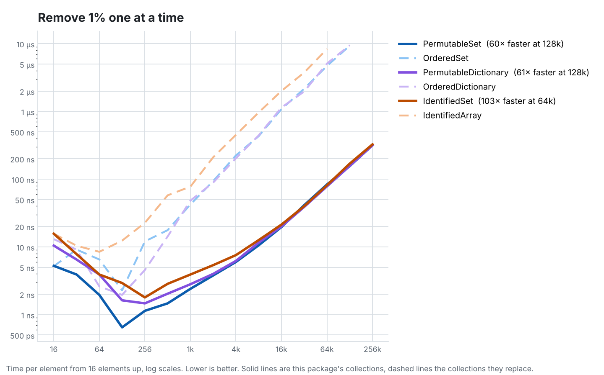

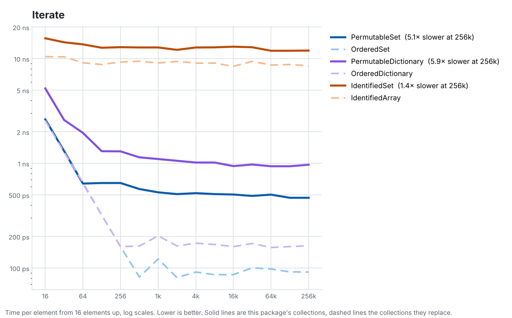

### Set operations

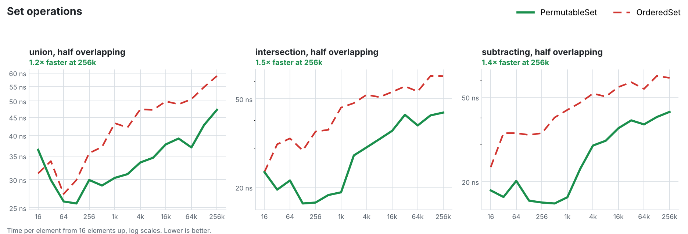

## Tables

The note after each operation compares the two at the largest size both finished. In the removal rows, "1%" means 1% of the elements are removed one at a time in random order. Each removal in `OrderedSet` and `IdentifiedArray` shifts every later element. In `PermutableSet` and `IdentifiedSet`, the last stored element fills the hole and only a 4-byte offset shifts.

### Arrangement vs Array

| Operation | Type | 16 | 1,024 | 16,384 | 262,144 |
| --- | --- | ---: | ---: | ---: | ---: |
| sort(by:) (1.3× faster) | Arrangement | 50 ns | 73 ns | 112 ns | 161 ns |
| | Array | 47 ns | 139 ns | 175 ns | 211 ns |
| shuffle() (1.7× faster) | Arrangement | 60 ns | 59 ns | 55 ns | 56 ns |
| | Array | 60 ns | 72 ns | 68 ns | 95 ns |
| reverse() (3.5× faster) | Arrangement | 10 ns | 2.40 ns | 1.76 ns | 2.16 ns |
| | Array | 10 ns | 7.28 ns | 7.48 ns | 7.63 ns |
| rotate by a third (2.2× faster) | Arrangement | 7.81 ns | 1.51 ns | 1.23 ns | 1.23 ns |
| | Array | 10 ns | 1.79 ns | 1.53 ns | 2.75 ns |
| move first to last (3.4× faster) | Arrangement | 13 ns | 1.10 ns | 0.77 ns | 0.80 ns |
| | Array | 2.56 ns | 1.67 ns | 1.70 ns | 2.73 ns |

### PermutableSet vs swift-collections OrderedSet

| Operation | Type | 16 | 1,024 | 16,384 | 262,144 |
| --- | --- | ---: | ---: | ---: | ---: |
| init from array (1.7× faster) | PermutableSet | 5.16 ns | 12 ns | 16 ns | 16 ns |
| | OrderedSet | 15 ns | 19 ns | 27 ns | 27 ns |
| append one at a time (1.7× faster) | PermutableSet | 23 ns | 45 ns | 48 ns | 50 ns |
| | OrderedSet | 36 ns | 79 ns | 85 ns | 84 ns |
| successful contains (1.5× faster) | PermutableSet | 7.81 ns | 13 ns | 18 ns | 20 ns |
| | OrderedSet | 13 ns | 21 ns | 27 ns | 29 ns |
| iteration (5.1× slower) | PermutableSet | 2.63 ns | 0.53 ns | 0.50 ns | 0.47 ns |
| | OrderedSet | 2.56 ns | 0.12 ns | 0.09 ns | 0.09 ns |
| remove 1% one at a time (55.1× faster) | PermutableSet | 5.25 ns | 2.40 ns | 20 ns | 318 ns |
| | OrderedSet | 5.19 ns | 42 ns | 1.1 µs | – |
| sort (about even) | PermutableSet | 31 ns | 35 ns | 61 ns | 88 ns |
| | OrderedSet | 18 ns | 44 ns | 68 ns | 90 ns |
| shuffle (1.4× faster) | PermutableSet | 63 ns | 58 ns | 56 ns | 60 ns |
| | OrderedSet | 63 ns | 78 ns | 77 ns | 86 ns |
| reverse (10.0× faster) | PermutableSet | 10 ns | 2.28 ns | 2.24 ns | 2.21 ns |
| | OrderedSet | 13 ns | 18 ns | 21 ns | 22 ns |
| rotate by a third (20.9× faster) | PermutableSet | 10 ns | 1.46 ns | 1.30 ns | 1.21 ns |
| | OrderedSet | 26 ns | 22 ns | 22 ns | 25 ns |
| move first to last (4.7× slower) | PermutableSet | 13 ns | 0.98 ns | 0.80 ns | 0.75 ns |
| | OrderedSet | 5.19 ns | 0.20 ns | 0.14 ns | 0.16 ns |
| union half-overlapping (1.2× faster) | PermutableSet | 36 ns | 30 ns | 38 ns | 47 ns |
| | OrderedSet | 31 ns | 43 ns | 50 ns | 59 ns |
| intersection half-overlapping (1.5× faster) | PermutableSet | 23 ns | 19 ns | 36 ns | 43 ns |
| | OrderedSet | 23 ns | 46 ns | 54 ns | 63 ns |
| subtracting half-overlapping (1.4× faster) | PermutableSet | 18 ns | 17 ns | 36 ns | 43 ns |
| | OrderedSet | 23 ns | 44 ns | 56 ns | 62 ns |

### IdentifiedSet vs Point-Free IdentifiedArray

| Operation | Type | 16 | 1,024 | 16,384 | 262,144 |
| --- | --- | ---: | ---: | ---: | ---: |
| init from array (3.7× faster) | IdentifiedSet | 77 ns | 36 ns | 40 ns | 39 ns |
| | IdentifiedArray | 172 ns | 151 ns | 137 ns | 144 ns |
| append one at a time (2.2× faster) | IdentifiedSet | 133 ns | 141 ns | 142 ns | 148 ns |
| | IdentifiedArray | 268 ns | 348 ns | 319 ns | 321 ns |
| successful contains(id:) (1.2× slower) | IdentifiedSet | 29 ns | 37 ns | 43 ns | 85 ns |
| | IdentifiedArray | 55 ns | 57 ns | 62 ns | 68 ns |
| subscript(id:) read (1.3× faster) | IdentifiedSet | 49 ns | 52 ns | 79 ns | 133 ns |
| | IdentifiedArray | 73 ns | 80 ns | 83 ns | 172 ns |
| iteration (1.4× slower) | IdentifiedSet | 16 ns | 13 ns | 13 ns | 12 ns |
| | IdentifiedArray | 10 ns | 9.07 ns | 8.44 ns | 8.54 ns |
| remove(id:) 1% (94.1× faster) | IdentifiedSet | 16 ns | 3.91 ns | 21 ns | 326 ns |
| | IdentifiedArray | 16 ns | 78 ns | 2.0 µs | – |
| removeAll(where:) half (3.0× faster) | IdentifiedSet | 18 ns | 30 ns | 30 ns | 29 ns |
| | IdentifiedArray | 44 ns | 83 ns | 83 ns | 87 ns |
| reverse() (16.0× faster) | IdentifiedSet | 10 ns | 2.36 ns | 2.21 ns | 2.10 ns |
| | IdentifiedArray | 26 ns | 28 ns | 33 ns | 34 ns |
| shuffle() (3.4× faster) | IdentifiedSet | 63 ns | 58 ns | 59 ns | 62 ns |
| | IdentifiedArray | 107 ns | 124 ns | 122 ns | 210 ns |
| sort(by:) (7.4× faster) | IdentifiedSet | 44 ns | 68 ns | 118 ns | 179 ns |
| | IdentifiedArray | 443 ns | 949 ns | 1.1 µs | 1.3 µs |
| rotate by a third (149.2× faster) | IdentifiedSet | 10 ns | 1.51 ns | 1.34 ns | 1.30 ns |
| | IdentifiedArray | 164 ns | 193 ns | 189 ns | 194 ns |
| move first to last (149.1× faster) | IdentifiedSet | 10 ns | 1.18 ns | 0.85 ns | 0.81 ns |
| | IdentifiedArray | 120 ns | 129 ns | 126 ns | 121 ns |

### PermutableDictionary vs swift-collections OrderedDictionary

| Operation | Type | 16 | 1,024 | 16,384 | 262,144 |
| --- | --- | ---: | ---: | ---: | ---: |
| init from keys and values (1.6× faster) | PermutableDictionary | 5.55 ns | 12 ns | 15 ns | 19 ns |
| | OrderedDictionary | 16 ns | 21 ns | 25 ns | 30 ns |
| subscript insert one at a time (1.3× faster) | PermutableDictionary | 36 ns | 60 ns | 60 ns | 68 ns |
| | OrderedDictionary | 47 ns | 80 ns | 81 ns | 91 ns |
| subscript lookup (3.0× faster) | PermutableDictionary | 7.81 ns | 16 ns | 18 ns | 23 ns |
| | OrderedDictionary | 31 ns | 40 ns | 48 ns | 71 ns |
| iteration (5.9× slower) | PermutableDictionary | 5.19 ns | 1.10 ns | 0.94 ns | 0.97 ns |
| | OrderedDictionary | 2.56 ns | 0.20 ns | 0.16 ns | 0.16 ns |
| removeValue(forKey:) 1% (57.0× faster) | PermutableDictionary | 10 ns | 2.81 ns | 20 ns | 316 ns |
| | OrderedDictionary | 13 ns | 48 ns | 1.1 µs | – |
| sort by key (about even) | PermutableDictionary | 44 ns | 72 ns | 91 ns | 122 ns |
| | OrderedDictionary | 42 ns | 83 ns | 109 ns | 120 ns |
| shuffle (1.5× faster) | PermutableDictionary | 63 ns | 58 ns | 54 ns | 56 ns |
| | OrderedDictionary | 73 ns | 83 ns | 78 ns | 81 ns |
| reverse (10.9× faster) | PermutableDictionary | 10 ns | 2.36 ns | 2.11 ns | 2.04 ns |
| | OrderedDictionary | 16 ns | 20 ns | 22 ns | 22 ns |
| rotate by a third (21.5× faster) | PermutableDictionary | 10 ns | 1.46 ns | 1.30 ns | 1.16 ns |
| | OrderedDictionary | 39 ns | 24 ns | 23 ns | 25 ns |
| move first to last (1.4× slower) | PermutableDictionary | 10 ns | 1.02 ns | 0.77 ns | 0.74 ns |
| | OrderedDictionary | 10 ns | 0.65 ns | 0.60 ns | 0.53 ns |
| sort by value (about even) | PermutableDictionary | 42 ns | 71 ns | 90 ns | 124 ns |
| | OrderedDictionary | 36 ns | 81 ns | 97 ns | 121 ns |
| shuffle values among keys (about even) | PermutableDictionary | 63 ns | 60 ns | 57 ns | 58 ns |
| | OrderedDictionary | 49 ns | 56 ns | 53 ns | 53 ns |

### Median times for one reorder

Measured with `swift run -c release PermutationComparisons`, which reports the median of 201 runs of the whole operation at 16,384 elements rather than time per element. `Arrangement` and `IdentifiedSet` hold `Record` values, `PermutableSet` holds `Int` values, and each pair receives the same random generator for shuffles. Every competitor uses its own API where it has one. `Array` and `OrderedSet` have no rotate, so they rebuild from two slices, and `OrderedSet` moves an element by removing and appending it. `IdentifiedArray` moves and rotates through `move(fromOffsets:toOffset:)`.

| Reorder | Arrangement | Array | PermutableSet | OrderedSet | IdentifiedSet | IdentifiedArray |
| --- | ---: | ---: | ---: | ---: | ---: | ---: |
| Sort | 2.2 ms | 3.4 ms (1.6×) | 1.1 ms | 1.3 ms (1.1×) | 2.2 ms | 20.0 ms (9.2×) |
| Shuffle | 126 µs | 290 µs (2.3×) | 126 µs | 492 µs (3.9×) | 141 µs | 1.5 ms (11×) |
| Reverse | 62 µs | 173 µs (2.8×) | 41 µs | 399 µs (9.8×) | 44 µs | 645 µs (15×) |
| Move first to last | 16 µs | 32 µs (2.0×) | 17 µs | 7 µs (0.4×) | 17 µs | 3.2 ms (187×) |
| Rotate by a third | 27 µs | 35 µs (1.3×) | 38 µs | 430 µs (11×) | 42 µs | 4.6 ms (110×) |

Each ratio is the competitor's time divided by the permutable collection's time, so a ratio above 1 means the permutable collection is faster. `OrderedSet` wins the single move because removing and appending one `Int` is a memmove plus a cheap index adjustment. `PermutableSet` shifts its offsets with one block copy too, but it also builds the `Permutation` that `move(from:to:)` returns, and a set that has never been reordered writes its offset table on that first reorder.

The same run also times one result of the cycle arithmetic directly. Applying a shuffle 1,000 times to an `Array` of 16,384 records takes 444 ms. Raising the shuffle to the 1,000th power with `raised(to:)` and applying it once to an `Arrangement` takes 163 µs, about 2,700× faster, because the power splits each cycle in one pass whatever the exponent.

## Reproducing

Start the **Benchmarks** workflow from the Actions tab. It uploads `results.json`, the charts and the tables as an artifact. Or run locally:

```sh
cd Benchmarks
swift run -c release PermutationBenchmarks run results.json --cycles 3 --max-size 256k
python3 Scripts/charts.py results.json Charts
python3 Scripts/tables.py results.json
```

`Scripts/charts.py` needs matplotlib (`pip install matplotlib`). The median comparison above comes from `swift run -c release PermutationComparisons`.
