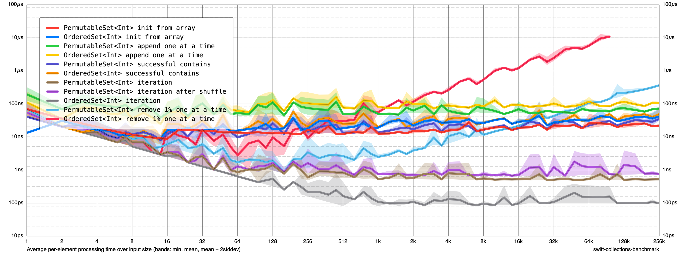
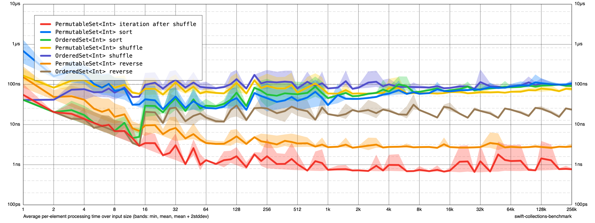
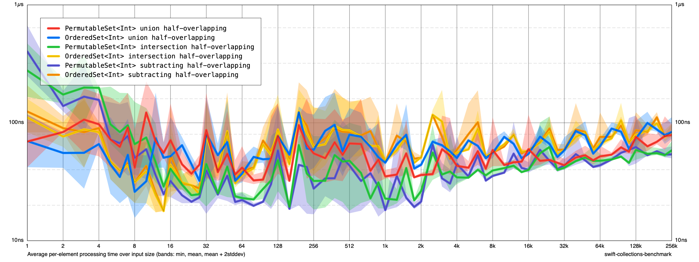
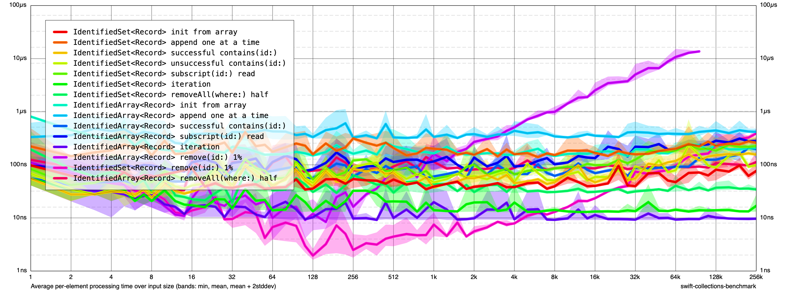
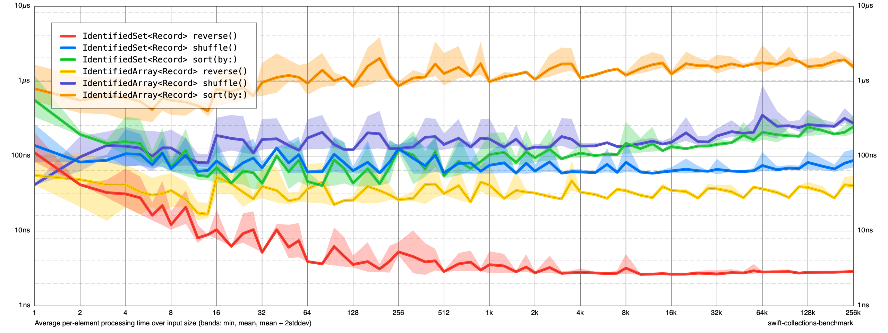

# Benchmark results

These tables compare the package's two ordered sets with the libraries people most often reach for:

- **`PermutableSet`** against [swift-collections](https://github.com/apple/swift-collections)' `OrderedSet`, both holding `Int`.
- **`IdentifiedSet`** against [Point-Free's](https://github.com/pointfreeco/swift-identified-collections) `IdentifiedArray`, both holding a typical app model: a UUID id, an `Int` sort key and 64 bytes of other fields (`Record`).

Every cell is **time per element**: the fastest of three runs of the whole operation, divided by the number of elements. Lower is better. The note after each operation compares the two at the largest size both finished.

Measured on 2026-11-06 on a GitHub `macos-latest` runner (Apple silicon), Swift 6.3.3, release build, with [swift-collections-benchmark](https://github.com/apple/swift-collections-benchmark). Absolute numbers will differ on your machine. The ratios are what to read.

## Summary

- **Reordering is where the design pays off.** Reverse runs 8.6× faster than `OrderedSet` and 12.8× faster than `IdentifiedArray`, and sort runs 7.1× faster than `IdentifiedArray`, because only 4-byte offsets move and the hash index is never touched.
- **Removing one element at a time scales.** At 16k elements, removing by value or id is about 50× faster than `OrderedSet` and about 90× faster than `IdentifiedArray`. At 256k, neither competitor finished inside the benchmark's time limit.
- **Lookups and inserts are mostly faster.** These run 1.3–2.7× faster across sizes. The exception is `contains(id:)` at 256k, which is 1.1× slower than `IdentifiedArray`.
- **Iteration is the one cost.** Each read goes through the order array, so a `for` loop over `Int`s is 5× slower than `OrderedSet` (0.5 ns against 0.1 ns per element) and 1.4× slower than `IdentifiedArray` over `Record`s. Converting to an `Array` or calling `withContiguousStorageIfAvailable` reads storage directly while the set is still in storage order.

### PermutableSet vs swift-collections OrderedSet

| Operation | Type | 16 | 1,024 | 16,384 | 262,144 |
| --- | --- | ---: | ---: | ---: | ---: |
| init from array (1.5× faster) | PermutableSet | 8.80 ns | 12 ns | 18 ns | 21 ns |
| | OrderedSet | 15 ns | 18 ns | 27 ns | 32 ns |
| append one at a time (1.5× faster) | PermutableSet | 34 ns | 50 ns | 54 ns | 67 ns |
| | OrderedSet | 34 ns | 79 ns | 91 ns | 100 ns |
| successful contains (1.3× faster) | PermutableSet | 5.25 ns | 13 ns | 18 ns | 32 ns |
| | OrderedSet | 13 ns | 20 ns | 27 ns | 42 ns |
| iteration (5.0× slower) | PermutableSet | 2.56 ns | 0.53 ns | 0.51 ns | 0.50 ns |
| | OrderedSet | 2.56 ns | 0.08 ns | 0.09 ns | 0.10 ns |
| remove 1% one at a time (53.3× faster) | PermutableSet | 5.19 ns | 2.36 ns | 21 ns | 353 ns |
| | OrderedSet | 10 ns | 50 ns | 1.1 µs | – |
| sort (1.1× slower) | PermutableSet | 26 ns | 30 ns | 64 ns | 103 ns |
| | OrderedSet | 16 ns | 44 ns | 71 ns | 91 ns |
| shuffle (1.4× faster) | PermutableSet | 55 ns | 59 ns | 62 ns | 68 ns |
| | OrderedSet | 70 ns | 78 ns | 82 ns | 94 ns |
| reverse (8.6× faster) | PermutableSet | 5.25 ns | 2.69 ns | 2.68 ns | 2.68 ns |
| | OrderedSet | 13 ns | 18 ns | 22 ns | 23 ns |
| union half-overlapping (about even) | PermutableSet | 39 ns | 34 ns | 42 ns | 71 ns |
| | OrderedSet | 29 ns | 45 ns | 53 ns | 73 ns |
| intersection half-overlapping (1.5× faster) | PermutableSet | 29 ns | 19 ns | 39 ns | 53 ns |
| | OrderedSet | 23 ns | 47 ns | 57 ns | 77 ns |
| subtracting half-overlapping (1.5× faster) | PermutableSet | 23 ns | 18 ns | 38 ns | 50 ns |
| | OrderedSet | 26 ns | 46 ns | 59 ns | 75 ns |

### IdentifiedSet vs Point-Free IdentifiedArray

| Operation | Type | 16 | 1,024 | 16,384 | 262,144 |
| --- | --- | ---: | ---: | ---: | ---: |
| init from array (2.7× faster) | IdentifiedSet | 86 ns | 37 ns | 39 ns | 67 ns |
| | IdentifiedArray | 190 ns | 150 ns | 153 ns | 184 ns |
| append one at a time (1.7× faster) | IdentifiedSet | 156 ns | 151 ns | 152 ns | 235 ns |
| | IdentifiedArray | 266 ns | 335 ns | 340 ns | 390 ns |
| successful contains(id:) (1.1× slower) | IdentifiedSet | 31 ns | 36 ns | 42 ns | 149 ns |
| | IdentifiedArray | 49 ns | 59 ns | 68 ns | 130 ns |
| subscript(id:) read (1.4× faster) | IdentifiedSet | 50 ns | 53 ns | 83 ns | 192 ns |
| | IdentifiedArray | 73 ns | 82 ns | 121 ns | 271 ns |
| iteration (1.4× slower) | IdentifiedSet | 16 ns | 13 ns | 13 ns | 13 ns |
| | IdentifiedArray | 10 ns | 9.68 ns | 9.16 ns | 9.32 ns |
| remove(id:) 1% (89.6× faster) | IdentifiedSet | 10 ns | 4.52 ns | 23 ns | 366 ns |
| | IdentifiedArray | 18 ns | 76 ns | 2.0 µs | – |
| removeAll(where:) half (2.8× faster) | IdentifiedSet | 21 ns | 30 ns | 30 ns | 33 ns |
| | IdentifiedArray | 65 ns | 78 ns | 83 ns | 91 ns |
| reverse() (12.8× faster) | IdentifiedSet | 7.81 ns | 2.73 ns | 2.62 ns | 2.82 ns |
| | IdentifiedArray | 31 ns | 29 ns | 34 ns | 36 ns |
| shuffle() (3.6× faster) | IdentifiedSet | 57 ns | 58 ns | 60 ns | 71 ns |
| | IdentifiedArray | 109 ns | 126 ns | 139 ns | 254 ns |
| sort(by:) (7.1× faster) | IdentifiedSet | 44 ns | 75 ns | 123 ns | 201 ns |
| | IdentifiedArray | 466 ns | 964 ns | 1.2 µs | 1.4 µs |

In the removal rows, "1%" means 1% of the elements are removed one at a time in random order. Each removal in `OrderedSet` and `IdentifiedArray` shifts every later element. In `PermutableSet` and `IdentifiedSet`, the last stored element fills the hole and only a 4-byte offset shifts.

## Charts

Each chart plots time per element (log scale) against size, from 1 to 256k elements. The bands show the spread across runs.

### PermutableSet and OrderedSet







### IdentifiedSet and IdentifiedArray





## Reproducing

Start the **Benchmarks** workflow from the Actions tab. It uploads `results.json`, the charts, and these tables as an artifact. Or run locally:

```sh
cd Benchmarks
swift run -c release PermutationBenchmarks run results.json --cycles 3 --max-size 256k
python3 Scripts/tables.py results.json
```
